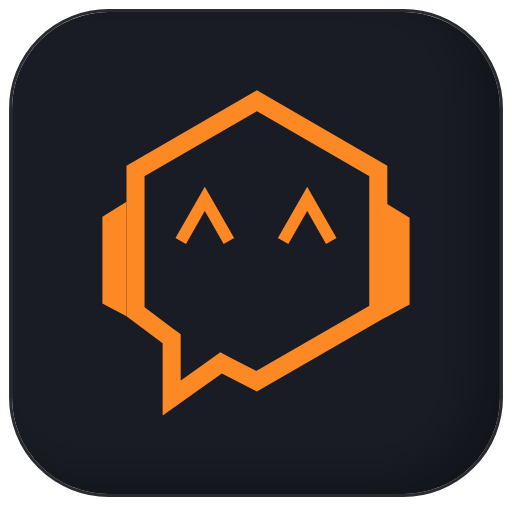

<p align="center">
  <picture>
    <source media="(prefers-color-scheme: dark)" srcset="packages/web/public/logo.png" />
    <source media="(prefers-color-scheme: light)" srcset="packages/web/public/logo-light.png" />
    
  </picture>
</p>

<h1 align="center">agentistics</h1>

<p align="center">
  <strong>Track · Analyze · Improve</strong><br/>
  Local-first analytics for AI coding assistants — on your own machine
</p>

<p align="center">
  <a href="https://github.com/agentistics/agentistics/releases/latest">
    
  </a>
  <a href="https://github.com/agentistics/agentistics/actions/workflows/release.yml">
    
  </a>
  <a href="LICENSING.md">
    
  </a>
  
  
</p>

<p align="center">
  <a href="#install"><strong>Install →</strong></a>
  &nbsp;·&nbsp;
  <a href="docs/security.md"><strong>Security model →</strong></a>
  &nbsp;·&nbsp;
  <a href="docs/cli.md"><strong>CLI →</strong></a>
</p>

<p align="center">
  
</p>

> Every screenshot and recording in this README is produced from a **synthetic demo fleet**
> (`packages/server/scripts/seed-demo.ts`) — real numbers, fictional names. See
> [Reproducing the media](#reproducing-the-media).

---

## What is agentistics?

agentistics reads what your AI coding assistants already write to disk and turns it into
tokens, costs, sessions and activity you can actually reason about. Nothing is uploaded: on a
single machine it never opens an outbound connection at all.

It tracks **six harnesses** side by side:

| Harness | Read from | Tokens & cost | Agent metrics | Notes |
|---|---|---|---|---|
| **Claude Code** | `~/.claude/` | ✅ | ✅ | The deepest source — agent invocations, git line counts, workflow runs |
| **Codex CLI** | `~/.codex/sessions/` | ✅ | — | |
| **Gemini CLI** | `~/.gemini/tmp/` | ✅ | — | Tokens, cost and model from its `chats/*.json` sessions; bootstrap-only stubs are skipped |
| **GitHub Copilot CLI** | `~/.copilot/session-state/` | ✅ | — | MCP tool calls counted |
| **Antigravity (`agy`)** | `~/.gemini/antigravity-cli/` | ✅ | — | Decoded from its own protobuf blobs; edit deltas for lines changed |
| **Kimi Code** | `~/.kimi-code/sessions/` | ✅ | — | Routes to other providers; priced by the routed model |

A metric a harness genuinely cannot produce renders as **N/A**, never as a confident `0` —
`HARNESS_CAPABILITIES` in `@agentistics/core` is the single source of truth for which is which.

---

## Install

<a name="install"></a>

### Linux / macOS / WSL — one line

```bash
curl -fsSL https://agentop.openvibes.tech/cli | sh
```

The installer is POSIX `sh`, so `| sh`, `| bash` and `| zsh` behave the same (including macOS's bash 3.2). Without root it installs to `~/.local/bin` and adds that directory to your PATH in the rc file of your login shell (`.zshrc`, `.bashrc`/`.bash_profile`, fish's `conf.d`, or `.profile`) — once; re-running does not duplicate the line.

At the end it asks two questions on your terminal (read from `/dev/tty`, so they work under `curl | sh`): *Start agentistics now? [Y/n]* and, if yes, *Start it automatically when you log in / boot? [Y/n]* — Enter answers yes to both. Yes to both runs `agentop setup --defaults` (archive mode `consolidate`, only if you never chose one) and `agentop autostart server enable`; yes then no starts the server once in the background (log in `~/.agentistics/server.log`). Then open <http://localhost:47292>. With no terminal (CI, Docker) nothing is asked or started and the commands are printed; `AGENTOP_INSTALL_START=yes|no` and `AGENTOP_INSTALL_AUTOSTART=yes|no` answer for automation. As root the start-on-login offer is skipped (it is a per-user service).

Or via npm — same binary, downloaded by `postinstall` from the same GitHub Release:

```bash
npm i -g @agentistics/agentop
```

Both install the identical Linux x86_64 binary; use whichever fits your workflow (npm is handy
when `agentop` is a dependency of another project's scripts).

Then just run it:

```bash
agentop
```

Bare `agentop` on a terminal opens the **control center** — one full-screen application in the
terminal's alternate buffer, so it adds nothing to your scrollback.

Bare `agentop` opens the control center: its tabs are **Services** (start / stop / restart this machine or the Docker machine; enable a boot service), **Setup**, **Logs**, **Commands**, **Help** and **Contribute**. Screens change with `←`/`→`, panes with `tab`, and the footer always names the keys that work *in the current focus*.

Open the dashboard at **http://localhost:47292** (the API + MCP endpoint stays on **47291**).

### Windows

Download the latest `.msi` or `.exe` from the [Releases page](https://github.com/agentistics/agentistics/releases/latest).
On first launch agentistics detects your Claude Code data path automatically (Windows native or WSL).

> **SmartScreen warning?** "More info → Run anyway". The binary is not code-signed yet.

### From source

```bash
git clone https://github.com/agentistics/agentistics.git
cd agentistics && bun install
bun run dev            # API (47291) + UI dev server (47292)
```

| Script | What it does |
|---|---|
| `bun run dev` | API + Vite dev server in parallel |
| `bun run watch` | OTel daemon only |
| `bun test` | Unit tests |
| `bun run build:binary` | Full build → `release/agentop` |

---

## The terminal dashboard

`agentop` opens the control center, and its **Dashboard** tab is a live dashboard that needs no
browser — Overview, Projects, History, Costs, Harnesses and Hardware, switched with the digits or
`tab`. (`agentop tui` is an alias for `agentop`.)

<p align="center">
  
</p>

---

## The dashboard

### Pages

| Page | Route | What it answers |
|---|---|---|
| Home | `/` | KPIs, activity over time, heatmap, hourly usage, highlights |
| Costs | `/costs` | Spend by model and date, budget and forecast, cache efficiency |
| Repositories | `/repositories` | Grouped by **git remote**, so one repo unifies across people, paths and machines |
| Actions | `/repositories/actions` | Sessions produced by CI runners |
| Tags | `/tags` | Saved, named groupings — "what did Client X cost this month" |
| Tools | `/tools` | Tool-call ranking and token attribution |
| Compare | `/compare` | Every harness side by side |
| Custom | `/custom` | Drag-and-drop layout builder |

### Comparing harnesses

<p align="center">
  
</p>

### Repositories

Metrics group by **normalized git remote** (`host/org/repo`), independent of where the repo is
checked out or which machine produced the work. A repo's detail page carries Overview,
Sessions, and a **Dynamic Workflows** tab that renders each
multi-agent Workflow run as a phase-by-phase timeline.

<p align="center">
  
</p>

### Tags

A tag is a saved grouping of sources — repositories, projects, harnesses or models —
optionally pinned to a date window. Tag responses are **aggregate-only**: counts and sums, never
session rows or transcripts.

<p align="center">
  
</p>

### Custom layouts

<p align="center">
  
</p>

### On a phone

The whole dashboard is responsive and installs as a PWA.

<p align="center">
  
</p>

---

## Exposing an instance beyond this machine

By default the instance listens on `127.0.0.1`. `AGENTISTICS_EXPOSURE` selects a profile —
`local` | `lan` | `public` — and **`public` permanently revokes every route that touches the host**
(shell, local chat, raw transcripts, MCP admin). The profile is the only thing that decides a
capability; no opt-in re-enables host power on `public`.

```bash
agentop doctor --exposed     # run this BEFORE opening a tunnel
```

A check that could not be verified reports `fail`, never a reassuring `pass`.

→ [docs/exposure.md](docs/exposure.md) · [docs/architecture.md](docs/architecture.md) · [docs/security.md](docs/security.md) · [SECURITY.md](SECURITY.md)

---

## The CLI — `agentop`

| Command | Purpose |
|---|---|
| *(bare)* / `start` | The control center |
| `setup` | First-run wizard (history consent, start on boot) |
| `server` | Web + API + MCP + daemon. `--bg` detaches |
| `restart` | Bounce a mode; `--rebuild` rebuilds first (a **full**, cacheless rebuild — `--cache` opts out) |
| `status` | Services + health |
| `tui` | The live terminal dashboard |
| `watch` | The OTel daemon only |
| `session` | Start / list / attach / kill background assistant sessions (tmux-backed), or a whole `batch` of them under one task |
| `hooks` | Teach Claude Code to fan work out across several assistants through agentop |
| `autostart` | Start a mode with the system (systemd user service) |
| `doctor` | Exposure preflight; `--exposed` checks against the strict public bar |
| `upgrade` · `check-update` | Update, or print a notice when one is due |

`agentop hooks install` installs two things into Claude Code — a **skill** that teaches it to split
independent work across several assistants and start them with `agentop session batch`, and a
**SessionStart hook** that tells each new session which of those are already running. A hook infers
nothing (it is a shell command on an event); the inference is Claude's, reading what the skill
teaches. Nothing is written to `~/.claude` until you run that command, and `uninstall` takes back
exactly what it wrote.

→ **Full reference:** [docs/cli.md](docs/cli.md) · [docs/claude-integration.md](docs/claude-integration.md)

---

## Costs, and where the prices come from

Costs are computed per session from a pricing table with **three layered sources**, merged in order
of trust: the built-in table (compiled in — the floor), the LiteLLM community dataset, and the
vendors' own pages. A source that fails or returns junk costs freshness, never the ability to price
anything; community rows that imply a unit change or sit more than tenfold from the built-in figure
are dropped.

**Settings → Pricing** lists every model *this machine has actually used*, each with its origin
(`official` / `community` / `builtin`) — so a model nobody can price is visible rather than silently
guessed at.

---

## Keeping history that the harnesses delete

Claude Code deletes session transcripts older than `cleanupPeriodDays` (30 by default) on every
startup. agentistics asks once, on first run, what to do about that:

| Mode | What it keeps |
|---|---|
| `consolidate` *(recommended)* | One small JSON of computed metrics per session — survives the cleanup, no chat duplicated |
| `full` | Additionally mirrors the raw transcripts, chat included. Grows without bound |
| `off` | Nothing — `~/.claude` only |

Revived sessions appear in lists and agent metrics but never inflate aggregate totals.

---

## Nay, and the MCP server

**Nay** is a chat panel that answers questions about your own data by calling the MCP tools.
It runs `claude --print` under the hood, so it spends your Claude subscription quota.

The **MCP server** exposes the same analytics as structured tools (summary, harnesses, projects,
sessions, costs, layout building, PDF export) and registers itself at user scope on first start —
so any Claude Code session can use them, not just Nay.

```bash
claude mcp list   # should show "agentistics"
```

→ [docs/nay.md](docs/nay.md) · [docs/mcp.md](docs/mcp.md)

---

## Also in the box

- **OpenTelemetry export** for Grafana, Datadog or any OTLP collector — [docs/opentelemetry.md](docs/opentelemetry.md)
- **Live sessions** — which assistants are running right now, detected from host processes. When
  detection is impossible (not Linux, no `/proc`, a container that cannot see the host) it says so
  instead of rendering an honest-looking zero
- **PDF export** of any combination of sections, period and theme
- **PT-BR + EN**, light and dark, throughout — CLI, TUI and web

---

## Documentation

| Doc | Contents |
|---|---|
| [docs/cli.md](docs/cli.md) | Every `agentop` command, flag and example |
| [docs/architecture.md](docs/architecture.md) | Structure, request lifecycle, build pipeline |
| [docs/security.md](docs/security.md) | Threat model, trust boundaries, the limits of each control |
| [docs/exposure.md](docs/exposure.md) | Exposing an instance safely |
| [docs/harness-contract.md](docs/harness-contract.md) | What each metric must MEAN across harnesses |
| [docs/data-sources.md](docs/data-sources.md) | Data sources, JSONL parsing, `SessionMeta` |
| [docs/metrics.md](docs/metrics.md) | Pricing table, cost formula, streak, cache |
| [docs/session-manager.md](docs/session-manager.md) | Background assistant sessions, the batch form, the cockpit |
| [docs/sessions-web.md](docs/sessions-web.md) | The Sessions workspace in the browser: chat, dialogs, modes, the aside, mobile |
| [docs/backup.md](docs/backup.md) | Backing up and restoring a machine's history, and versioning it to GitHub |
| [docs/vscode-extension.md](docs/vscode-extension.md) | The VS Code extension: the fleet and the dashboard inside the editor |
| [docs/claude-integration.md](docs/claude-integration.md) | The Claude Code skill + SessionStart hook `agentop hooks` installs |
| [docs/nay.md](docs/nay.md) · [docs/mcp.md](docs/mcp.md) | The chat assistant and the MCP tools |

---

## Reproducing the media

<a name="reproducing-the-media"></a>

The GIFs above are recorded from a demo fleet, never from a real machine — a published recording
cannot be taken back, and a real project name or repository in one is a leak.

```bash
# 1. a pseudonymized fleet, derived from this machine's computed metrics
#    (never from transcripts, so chat cannot reach it by construction)
bun run packages/server/scripts/seed-demo.ts --split 3 --force

# 2. run them
HOME=~/.agentistics-demo-home-1 PORT=47391 ./release/agentop server &

# 3. record
packages/server/scripts/record-all.sh                    # terminal → .cast + .gif
bun run packages/server/scripts/record-web.ts            # web → .gif
```

Terminal recordings are [asciinema](https://asciinema.org) casts (`casts/*.cast`, embeddable as a
real player with selectable text) rendered to GIF with [`agg`](https://github.com/asciinema/agg).

---

## Contributing

See [CONTRIBUTING.md](CONTRIBUTING.md). Everything in this project is in English — code, comments,
commits, docs. Contributions are accepted under the [Contributor License Agreement](CLA.md).

---

## License

Agentistics is **source-available** under the [Functional Source License 1.1 (FSL-1.1-ALv2)](LICENSE),
and each release becomes **Apache-2.0 two years after it ships**. Use it personally or inside your
company, self-host it, modify it and build integrations for free. What the licence does not allow is
offering it to others as a competing commercial product or service: a hosted service, a rebrand or a
resale. Versions up to and including `mit-final` remain MIT. See [LICENSING.md](LICENSING.md) for the
full picture and [TRADEMARKS.md](TRADEMARKS.md) for the name and logo.

---

## Star History

<p align="center">
  <a href="https://star-history.com/#agentistics/agentistics&Date">
    <picture>
      <source media="(prefers-color-scheme: dark)" srcset="https://api.star-history.com/svg?repos=agentistics/agentistics&type=Date&theme=dark" />
      <source media="(prefers-color-scheme: light)" srcset="https://api.star-history.com/svg?repos=agentistics/agentistics&type=Date" />
      
    </picture>
  </a>
</p>

---

<p align="center">
  Made with ♥ for the vibe coding community
</p>
